<p align="center">
  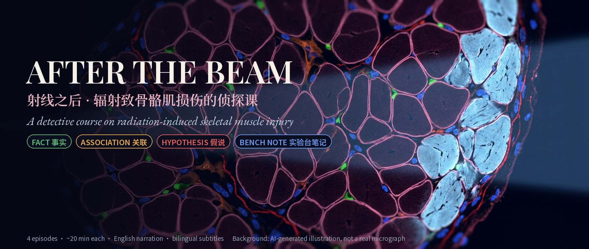
</p>

<h1 align="center">射线之后 · 辐射致骨骼肌损伤的侦探课<br><sub>After the Beam · Radiation Muscle Detective Course</sub></h1>

<p align="center">
  <strong>把一个基础研究课题，拍成一部四集侦探片，再拆成可以闭卷自测的学习单。</strong><br>
  A four-episode detective story about why irradiated muscle grows thin and stiff, built for retrieval practice.
</p>

<p align="center">
  面向刚进入基础研究的医学生、研究生和临床医生：4 集 × 约 20 分钟英文旁白视频，上英下中双语字幕，每句标注证据等级，每集配学习单、提取练习、费曼输出和实验台任务。<br>
  For beginners in basic research: 4 × ~20-min narrated episodes, bilingual subtitles, sentence-level evidence tags, and a study guide for every episode.
</p>

<p align="center">
  <a href="https://github.com/TUANZIDING/radiation-muscle-detective-course/releases/tag/v0.1"></a>
  <a href="references/literature-v0.1.md"></a>
  <a href="#evidence"></a>
  <a href="LICENSE"></a>
</p>

<p align="center">
  <code>侦探式叙事</code> · <code>双语逐句文稿</code> · <code>证据分层</code> · <code>提取练习</code> · <code>间隔复习</code> · <code>实验台笔记</code> · <code>可复现制作管线</code>
</p>

<p align="center">
  <a href="#episodes">四集一览</a> ｜ <a href="#method">学习方法</a> ｜ <a href="#evidence">证据标签</a> ｜ <a href="#gallery">画面</a> ｜ <a href="#tissue">真实组织</a> ｜ <a href="#files">仓库结构</a> ｜ <a href="#pipeline">制作管线</a> ｜ <a href="#license">版权</a>
</p>

<p align="center"><sub>当前版本 v0.1（2026-10-29）。顶部大图为 AI 生成的示意插画，不是真实显微照片；真实组织照片见 <a href="#tissue">真实组织</a> 一节并注明来源。仅用于教学，不构成临床建议。</sub></p>

---

<a id="episodes"></a>

## 四集一览 · Episodes

一根肌纤维被射线击中却活了下来，可多年后整块肌肉还是变细、变硬。凶手是谁？每集追一条线索，最后在第 4 集做结案陈词。

| 集 | 标题 | 时长 | 追的线索 | 学习单 | 文稿 |
| --- | --- | --- | --- | --- | --- |
| 1 | **子弹与蓝图** · The Bullet and the Blueprint | 18:28 | 射线怎样损伤 DNA；NHEJ 与 HR；修复 / 死亡 / 衰老三种命运；成熟肌纤维为何扛得住 | [学习单](episodes/ep1-the-bullet-and-the-blueprint/study-guide-v0.1.md) | [文稿](episodes/ep1-the-bullet-and-the-blueprint/transcript-v0.1.md) |
| 2 | **守护者** · The Guardians | 20:28 | 卫星细胞的发现（Mauro 1961）、必要性证明（2011）、静息与隐藏储备、儿童肌肉的脆弱 | [学习单](episodes/ep2-the-guardians/study-guide-v0.1.md) | [文稿](episodes/ep2-the-guardians/transcript-v0.1.md) |
| 3 | **邻居变脸** · The Neighbors Turn | 21:27 | FAP 的两副面孔、巨噬细胞时序、TGF-β 之锁、血管与线粒体、晚期纤维化工作模型 | [学习单](episodes/ep3-the-neighbors-turn/study-guide-v0.1.md) | [文稿](episodes/ep3-the-neighbors-turn/transcript-v0.1.md) |
| 4 | **从实验台到病床** · From Bench to Bedside | 21:36 | 人体证据、模型与剂量（BED）、矛盾线索的调和、干预尝试、五个悬案 | [学习单](episodes/ep4-from-bench-to-bedside/study-guide-v0.1.md) | [文稿](episodes/ep4-from-bench-to-bedside/transcript-v0.1.md) |

**▶ 观看**：720p 视频（每集 ≤40 MB）在 [Releases v0.1](https://github.com/TUANZIDING/radiation-muscle-detective-course/releases/tag/v0.1) 下载；双语字幕在 [`subtitles/`](subtitles/)，可在播放器里单独加载。

<p align="center">
  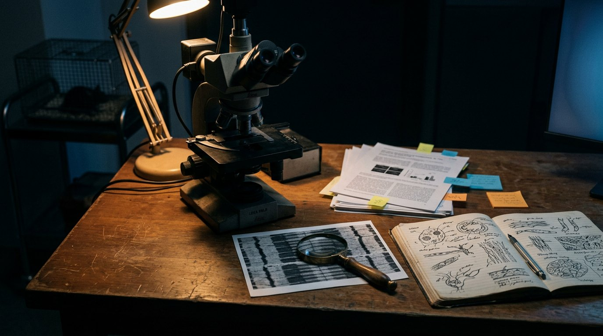
  <br><sub>侦探的工作台：每条线索都要追到原始论文。（AI 生成示意图）</sub>
</p>

---

<a id="method"></a>

## 学习方法 · How to study with it

视频只是入口。真正让知识留下来的是**先预测、再提取、再输出、再间隔复习**——这与 [learning-method-playbook](https://github.com/TUANZIDING/learning-method-playbook) 中证据最强的两种方法（提取练习、间隔复习）一致。

```text
① 观看前预测（5 分钟） → ② 看视频，遇到 🟠/🔴 暂停追问（20 分钟）
   → ③ 闭卷提取练习 5 题（10 分钟） → ④ 费曼一段话（10 分钟）
   → ⑤ 实验台任务：把机制变成实验设计（15 分钟） → ⑥ 1 / 3 / 7 天后只重做提取练习
```

| 你想做什么 | 从这里开始 |
| --- | --- |
| 两周内入门这个方向 | 每天一集学习单，第 5–8 天做间隔复习，第 9–14 天精读 [文献清单](references/literature-v0.1.md) 中标为核心的论文 |
| 只想弄懂“卫星细胞到底怎么了” | 第 2 集学习单 → 第 4 集“矛盾线索”一节 |
| 准备组会 / 开题 | 第 3 集工作模型 + 第 4 集五个悬案，每个悬案都可以写成一页课题设计 |
| 练英文听力和科研表达 | 先看中英字幕，第二遍只开英文，第三遍对照 [逐句文稿](episodes/) 跟读 |
| 学习怎样区分相关与因果 | 只看每集中 🟠 关联、🔴 假说的句子，写下“要证明它需要什么实验” |

---

<a id="evidence"></a>

## 证据标签 · Evidence tags

每句旁白都带一个标签，画面右上角同步显示。科学表述一律交代**物种、剂量、年龄、时间点**。

| 标签 | 含义 | 四集句数 |
| --- | --- | --- |
| 🟢 **事实** FACT | 有直接实验支持（仍需注明模型） | 402 |
| 🟠 **关联** ASSOCIATION | 同时出现，不等于因果（如单细胞测序推断、横断面队列） | 36 |
| 🔴 **假说** HYPOTHESIS | 合理但尚未检验，或作者 / 叙述者的推断 | 53 |
| 🔵 **实验台笔记** BENCH NOTE | 动手做实验时的门控、对照、时间点和陷阱 | 69 |

---

<a id="gallery"></a>

## 画面 · Gallery

以下均为成片真实截图（1080p 渲染，缩至 1280 px）。配色贯穿全系列：卫星细胞绿、FAP 橙、巨噬细胞紫、毛细血管红、肌纤维玫红、瘢痕冰蓝。

<table>
<tr>
<td width="50%" align="center" valign="top">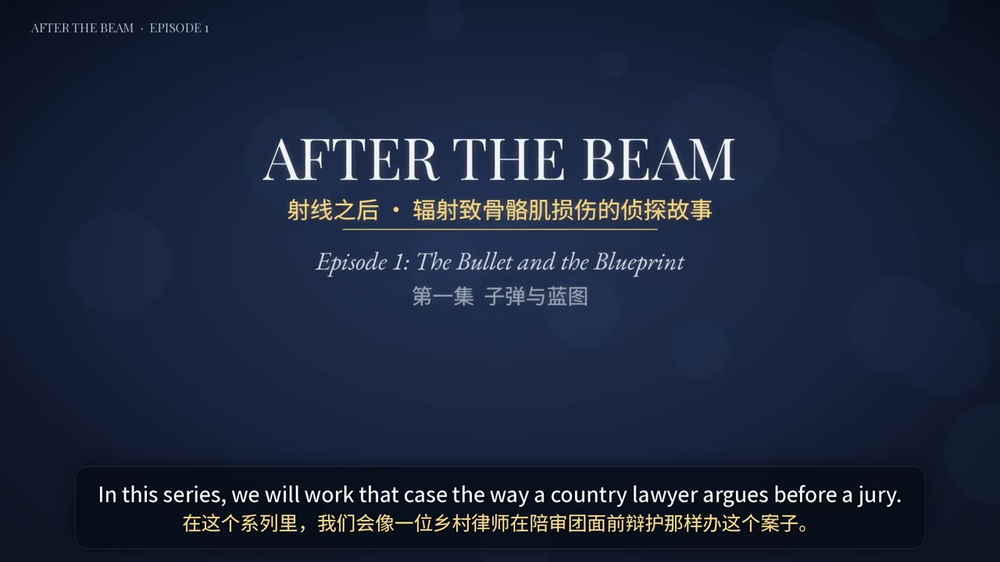<br><sub><b>第 1 集 · 片头</b><br>Episode 1 title card</sub></td>
<td width="50%" align="center" valign="top">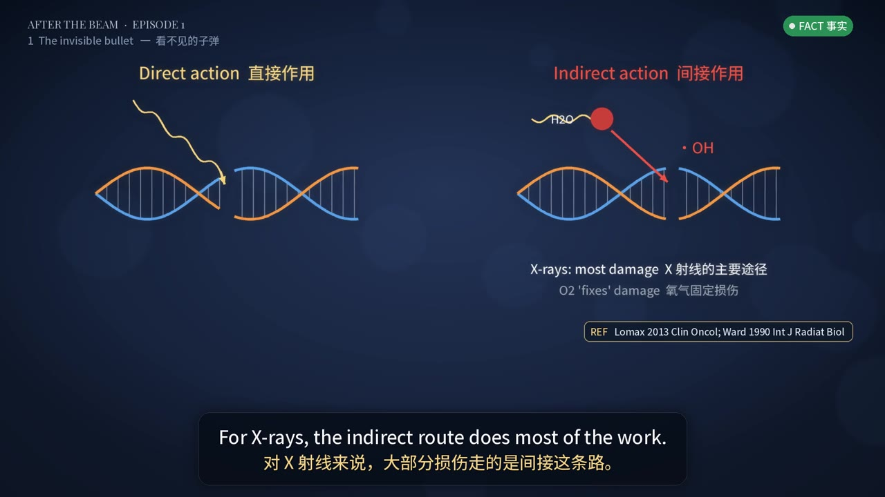<br><sub><b>直接作用 vs 间接作用</b><br>X-rays mostly damage DNA indirectly</sub></td>
</tr>
<tr>
<td width="50%" align="center" valign="top">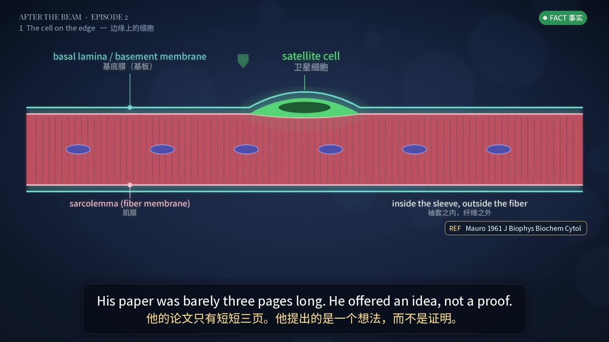<br><sub><b>卫星细胞：住在肌膜与基底膜之间</b><br>Satellite cell under the basal lamina</sub></td>
<td width="50%" align="center" valign="top">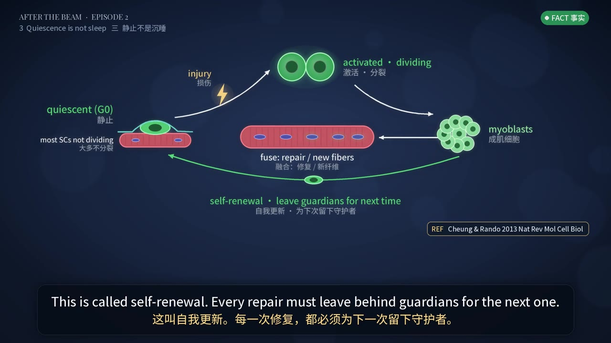<br><sub><b>静息 → 激活 → 融合 / 自我更新</b><br>Quiescence, activation, self-renewal</sub></td>
</tr>
<tr>
<td width="50%" align="center" valign="top">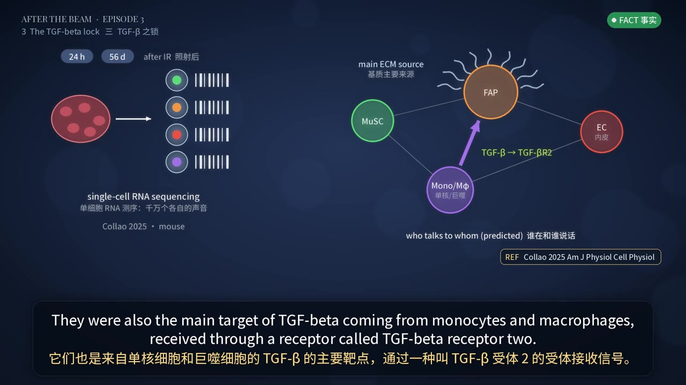<br><sub><b>单细胞测序：谁在和谁说话（预测）</b><br>Predicted ligand–receptor talk, 🟠 association</sub></td>
<td width="50%" align="center" valign="top">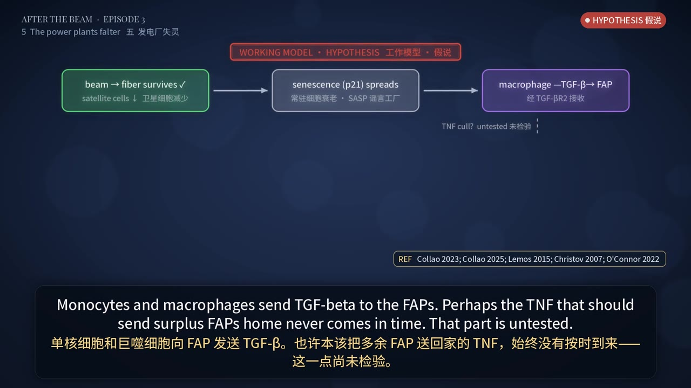<br><sub><b>晚期纤维化工作模型（假说）</b><br>Working model, 🔴 hypothesis</sub></td>
</tr>
<tr>
<td width="50%" align="center" valign="top">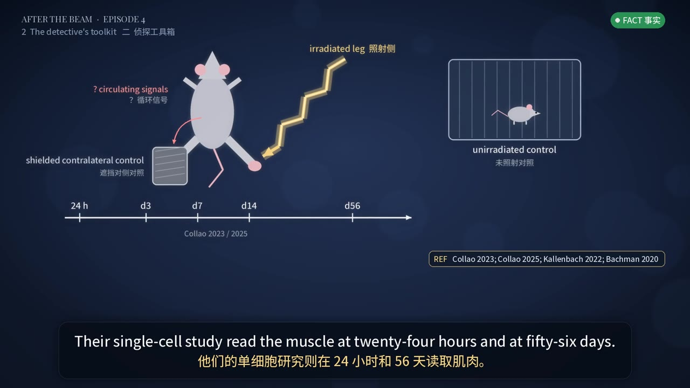<br><sub><b>研究模型：单侧照射、对侧屏蔽、多时间点</b><br>Model, shielding and timepoints</sub></td>
<td width="50%" align="center" valign="top">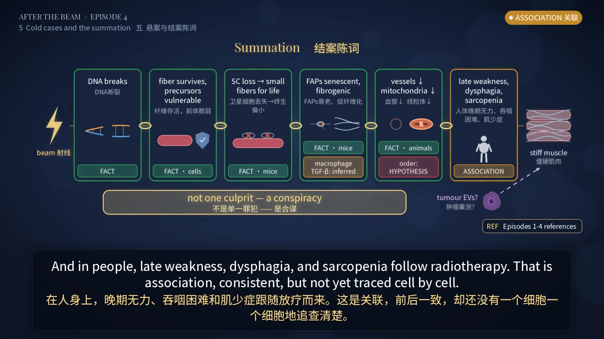<br><sub><b>结案陈词：不是单一凶手，而是合谋</b><br>Summation: a conspiracy, not one culprit</sub></td>
</tr>
</table>

---

<a id="tissue"></a>

## 真实组织 · Real tissue

示意图之外，先认得真实的肌肉长什么样。两张均为 Wikimedia Commons 开放授权图片，**不来自系列引用的研究**，仅作形态参考。

<table>
<tr>
<td width="55%" align="center" valign="top">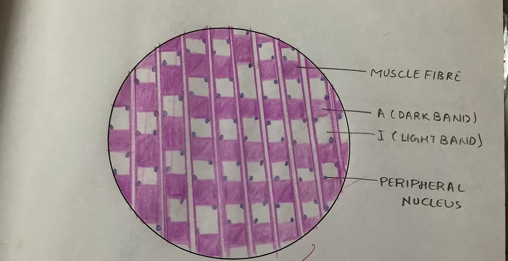<br><sub><b>正常骨骼肌 HE 切片</b>：多核、核位于周边<br>Veeresh likhitha · <a href="https://commons.wikimedia.org/wiki/File:Skeletal_muscle_histology.jpg">Wikimedia Commons</a> · CC BY-SA 4.0</sub></td>
<td width="45%" align="center" valign="top">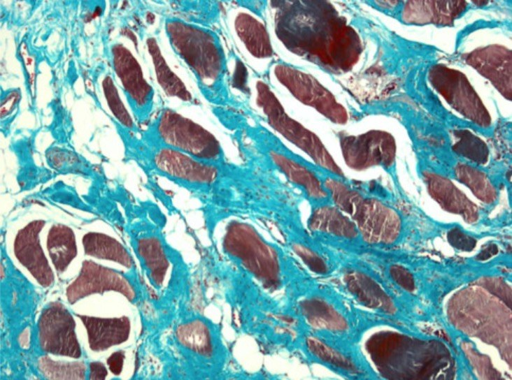<br><sub><b>人背部肌肉三色染色</b>：蓝绿色为胶原 / 纤维化<br>Lenoir T, Guedj N, Boulu P, Guigui P, Benoist M · Wikimedia Commons · CC BY-SA 4.0</sub></td>
</tr>
</table>

---

<a id="files"></a>

## 仓库结构 · Repository

```text
episodes/                  每集一个文件夹：study-guide（学习单）+ transcript（双语逐句文稿，含证据标签与参考）
references/                literature-v0.1.md（核心 40 + 补充 16 篇，DOI/PMID 已核）· series-outline-v0.1.md
subtitles/                 四集上英下中 SRT 字幕
tools/                     制作管线：旁白数据、配音、钢琴配乐、机制图、逐帧渲染、字幕与文档生成
publish/                   微信视频号文案
docs/images/               主页图片（AI 示意图、成片截图、开放授权组织照片）
```

视频文件不放进 git，统一挂在 [Releases](https://github.com/TUANZIDING/radiation-muscle-detective-course/releases)。

---

<a id="pipeline"></a>

## 制作管线 · Pipeline

全部用免费、可复现的工具生成，没有付费素材。

| 环节 | 做法 | 文件 |
| --- | --- | --- |
| 旁白与画面数据 | 每句一个元组：英文、中文、证据标签、参考、画面状态 | `tools/ep<N>-data-*.py` |
| 配音 | edge-tts `en-US-ChristopherNeural`（-12% 语速，-4 Hz），按文本缓存 | `tools/build-audio-v0.1.py` |
| 配乐 | numpy 合成的干净单钢琴，无噪声铺底，比人声低约 25 dB | `tools/build-piano-v0.1.py` |
| 机制图 | Pillow 自绘：2× 超采样抗锯齿、发光、渐变背景 | `tools/prims.py` · `tools/diagrams-ep*.py` |
| 动画与渲染 | 缓慢推近、步骤淡入、场景交叉淡化，逐帧管道进 ffmpeg（分段并行） | `tools/render-video-v0.2.py` · `tools/run-render-v0.2.sh` |
| 合成与压缩 | 拼接、混音、loudnorm -16 LUFS，按时长算码率出 ≤40 MB 版本 | `tools/build-final-v0.2.sh` |
| 字幕与文档 | 由时间轴生成 SRT；由数据文件生成学习单和文稿 | `tools/make-srt-v0.1.py` · `tools/build-github-docs-v0.1.py` |

脚本最初在一个 `script/` 目录下运行，路径通过环境变量 `RM_ROOT` 指向工作目录；字体（Noto Sans/Serif SC、Playfair Display、EB Garamond，均为 OFL）需自行下载到 `assets/fonts/`。

---

## 已知局限 · Limitations

- 第 2 集卫星细胞电镜画面为手绘示意（未找到开放授权的原图）。
- 巨噬细胞在照射肌肉中的逐日时序、衰老细胞清除（senolytics）在体实验、血管与干细胞谁先倒——目前都没有直接研究，片中均标为 🔴 假说。
- 少数条目仅核对了摘要（如 Gans 等），使用前请回到全文。
- AI 配音偶有重音不自然；中文字幕为意译，术语以英文原文为准。

---

<a id="license"></a>

## 版权与许可 · License

- 文稿、学习单、自绘机制图与视频：**CC BY 4.0**；代码（`tools/`）：**MIT**，见 [`LICENSE`](LICENSE)。
- 不收录出版社 PDF 与论文原图；参考文献只列书目信息与 DOI/PMID。
- 第三方图片保留原许可（CC BY-SA），见 [`THIRD_PARTY_NOTICES.md`](THIRD_PARTY_NOTICES.md)。
- **仅用于教学**，不作为临床诊疗依据。

<p align="center"><sub>Haixiang Ding, MD · Emergency and Trauma Surgeon · PhD Candidate in Clinical Medicine, Soochow University</sub></p>
